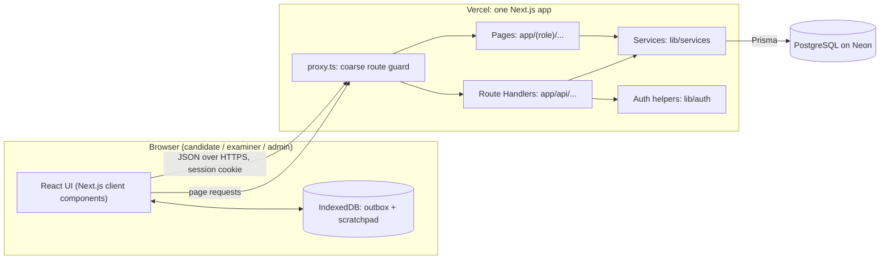
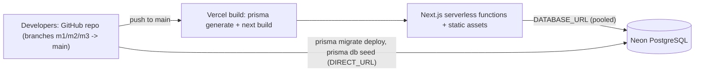

# Architecture

Secure Examination Management System - Web-e-Thon, Technoverse 5.0.
Companion documents: [00_SHARED_CONTRACT.md](00_SHARED_CONTRACT.md) (team contract), [api.md](api.md), [database.md](database.md), [frontend.md](frontend.md), [systemdesign.md](systemdesign.md).

---

## 1. Architectural goals

The problem statement turns into a short list of non-negotiable properties. Every design choice below traces back to one of them.

| # | Property | Where the spec asks for it | How the architecture delivers it |
|---|---|---|---|
| G1 | **Authorization enforced on the server** | 3.1, section 06 "Security & privacy" | One guard (`requireRole`) at the top of every route, plus ownership checks. UI hiding is cosmetic only. |
| G2 | **Time enforced independently of the device clock** | section 06 "Data integrity" | `expiresAt` stored in the DB at attempt start; all accept/reject decisions use server time. |
| G3 | **No duplicate submissions, consistent grading** | section 06 "Data integrity", 3.7 | Unique constraints + conditional updates + one transaction for finalize/grade. |
| G4 | **Assigned questions and marking scheme preserved for an active attempt** | 3.3, section 06 | Per-attempt snapshot (`AttemptQuestion.snapshot`). |
| G5 | **Graceful handling of refresh, interrupted requests, repeated actions** | 3.5, section 06 "Validation & reliability" | Idempotent endpoints, client outbox, sequence numbers, resume from server state. |
| G6 | **Protect answer keys, credentials, personal data** | section 06 "Security & privacy" | Keys never leave the server for candidates; password hashes never returned; public verify page returns minimal data. |
| G7 | **Free to run, no billing-dependent features** | section 06 "Technical freedom & fairness" | Vercel Hobby + Neon free + open-source libraries; no paid APIs. |
| G8 | **Explainable and maintainable** | section 06 "Architecture & maintainability" | Layered code, one language, shared validation schemas, documented trade-offs. |

---

## 2. System context



One deployable unit (the Next.js app) talks to one database. There is no separate backend service, queue, cache or worker. That is a deliberate simplification for a 10-hour build; [systemdesign.md](systemdesign.md) explains what would change at larger scale.

**Default data path.** Client components fetch JSON from `app/api/*` through TanStack Query. Server components are used for layout and for the initial role redirect, but data screens use the API so there is **one path to test and secure**. If a server component ever reads data directly, it must call the same service functions and the same guards.

---

## 3. Layered design

```
HTTP request
  -> proxy.ts                 coarse: is there a valid session cookie? is this URL allowed for this role?
  -> Route Handler            thin: parse request, call guard, validate, call service, shape response
  -> apiHandler() wrapper     catches errors -> consistent JSON error format
  -> Guard (lib/auth)         requireRole / assertExamOwner / assertEnrolled
  -> Zod schema               lib/validation: body, query, params
  -> Service (lib/services)   business rules, transactions, state transitions
  -> Prisma                   the only code that touches the database
```

| Layer | Responsibility | Must not |
|---|---|---|
| Route Handler | Translate HTTP to a service call and back | Contain business rules or Prisma queries beyond trivial reads |
| Guard | Identify the caller, check role and ownership | Trust anything the client sent about roles |
| Validation | Reject malformed input with field-level messages | Be duplicated on the client (the client imports the same schema) |
| Service | Lifecycle rules, grading, attempt engine, reports data | Know about HTTP, cookies or response codes |
| Prisma | Queries and transactions | Be called from React components |

**Why this matters to judges:** "clear separation of responsibilities" is listed under Technical Quality. Business rules (grading, attempt state, exam lifecycle) live in testable service functions rather than inside route files.

### 3.1 Folder structure

```
app/
  (auth)/login/                       M3
  (candidate)/dashboard/              M3
  (candidate)/exam/[attemptId]/       M3   exam workspace
  (candidate)/results/[attemptId]/    M3
  (admin)/admin/users/                M2
  (examiner)/examiner/...             M2
  verify/[code]/                      M2   public verification page
  api/
    auth/  me/                        M1   (me/preferences: M3)
    candidate/  attempts/             M1   (attempts/[id]/review: M2)
    exams/[id]/attempts, results/publish   M1
    users/ exams/ questions/ import/ candidates/ answers/ announcements/ monitor/ analytics/ reports/ verify/   M2
lib/
  auth/        M1   session, hashing, guards
  services/    M1   examLifecycle, attemptService, gradingService, resultService
  reports/     M2   PDF, QR, analytics queries
  validation/  shared   Zod schemas (client + server)
  offline/     M3   IndexedDB outbox, sync engine, clock calibration
  constants.ts shared   see section 6
components/
  ui/          M3   design system
  candidate/   M3
  examiner/    M2
prisma/        M1   schema.prisma, migrations, seed.ts
proxy.ts       M1   coarse route guard
```

The ownership column is the merge-conflict strategy from the shared contract.

---

## 4. Request lifecycle (worked example)

`PUT /api/attempts/:id/answers` (autosave):

1. **proxy.ts** - checks the session cookie signature (`jose`). No cookie -> 401. It does not decide permissions beyond coarse URL prefixes.
2. **Route handler** wrapped by `apiHandler()`.
3. **`requireRole("CANDIDATE", "EXAMINER")`** - loads the user from the DB, confirms `active` and the role. Failure -> 401/403. Examiners are allowed because sandbox attempts use the same endpoint.
4. **Ownership** - loads the attempt and confirms `attempt.userId === session.userId`. Failure -> **404** (existence not revealed). Then the role must match the attempt (`isSandbox` -> EXAMINER, otherwise CANDIDATE) -> else 403.
5. **Zod** validates the body shape (`items[]`, sizes, types). Failure -> 400 `VALIDATION_ERROR`.
6. **`attemptService.saveAnswers()`**:
   - `finalizeIfExpired` (only finalizes after the grace window).
   - For each item: time check (normal / grace / too late), per-item validity, `seq` check, conditional write.
7. **Response** with per-item statuses plus `serverNow` and `expiresAt` for client clock recalibration.

Any thrown `AppError` becomes `{ "error": { "code", "message", "fields?", "details?" } }`; unknown errors become a generic 500 with no stack trace.

---

## 5. Cross-cutting concerns

### 5.1 Authentication and sessions
- Email + password login. Passwords hashed with bcrypt (`bcryptjs`) or argon2; never logged or returned.
- On success the server sets a **signed JWT** (via `jose`) in an `httpOnly; Secure; SameSite=Lax` cookie containing `userId` and `role`. Default lifetime 12 hours.
- `proxy.ts` (Next.js 16's replacement for `middleware.ts`) runs on the Node.js runtime and verifies the cookie with `jose`. Keep it light: no database queries, and **`bcryptjs` is only called inside route handlers**.
- Login is rate-limited (see section 6).
- Responses to a failed login are identical for unknown email, wrong password and deactivated account ("Invalid email or password") so the endpoint does not reveal which accounts exist.

### 5.2 Authorization
Two layers, with the second one authoritative:

1. `proxy.ts` - coarse URL guard. `/admin/*` needs ADMIN; `/examiner/*` needs EXAMINER or ADMIN; candidate pages need CANDIDATE; `/login` and `/verify/*` are public.
2. **Per-route guards** - `requireRole` on every API route, then ownership checks.

`requireRole` re-reads the user row on each call, so deactivating a user or changing a role takes effect immediately even if that user still holds a valid cookie.

| Resource | ADMIN | EXAMINER | CANDIDATE |
|---|---|---|---|
| Users | full management | none (can use `GET /api/candidates` lookup only) | none |
| Question bank | all | own questions | none |
| Exams | all | own exams | only enrolled exams, through candidate endpoints |
| Enrollments | all | own exams | none |
| Attempts (real) | read via review/monitor | read for own exams | own attempts only |
| Sandbox attempts | none | own exams only | none |
| Monitor / announcements (write) | all | own exams | none (reads announcements for enrolled exams) |
| Grading | all | own exams | none |
| Results | all | own exams | own attempt, only after publication |
| PDF reports | all | own exams | own attempt, only after publication |
| `/verify/:code` | public | public | public |

Failure semantics: wrong **role** -> 403 `FORBIDDEN`. Someone else's **resource** -> 404 `NOT_FOUND`.

### 5.3 Validation
- Zod schemas live in `lib/validation/*` and are imported by both forms (react-hook-form resolver) and route handlers. The server is authoritative; client validation is for usability.
- Schemas are **strict** (unknown keys rejected) to prevent mass-assignment, e.g. a client cannot send `role` or `status` fields that an endpoint does not accept.
- Limits: see section 6.

### 5.4 Error handling
- One response format (see `00_SHARED_CONTRACT.md` section 4 and [api.md](api.md) section 1).
- Services throw typed `AppError(code, httpStatus, message, fields?, details?)`; only `apiHandler()` converts errors to responses.
- Client side: a single fetch wrapper maps error codes to UI messages and decides retry behaviour (retry network errors and 5xx for autosave; never retry 4xx).

### 5.5 Time
- All enforcement uses the server clock (`new Date()` in the service layer).
- Timestamps are stored as UTC and sent as ISO-8601 strings.
- Every attempt-related response includes `serverNow` so clients can calibrate their display timer. The client clock is **display-only**.

### 5.6 Audit and observability
- `AuditLog` records privileged actions: exam publish, result publish, grade changes, user role/activation changes, imports.
- `Incident` records candidate-side signals (tab hidden, paste, disconnect, late sync) and is presented as *indicators for human review*, never automatic penalties.
- Server logs: structured one-line JSON for errors (code, route, userId, no payloads containing answers or passwords).

### 5.7 Privacy
- Candidate payloads never contain `isCorrect` (see `toCandidateQuestion()` in `lib/services`).
- The public verification page returns: validity, exam title, issue date, masked name (initials), pass/fail band. No email, roll number, answers or exact score.
- Integrity signals collect only an event type and small metadata (e.g. duration). No screenshots, keystrokes, camera or microphone.

---

## 6. Shared constants (`lib/constants.ts`)

One file, imported by services and the client where relevant. Values are defaults to tune, not spec requirements.

| Constant | Value | Used for |
|---|---|---|
| `GRACE_MS` | 120000 (2 min) | Late-sync window after `expiresAt`; lazy finalization threshold |
| `HEARTBEAT_INTERVAL_MS` | 15000 | Candidate heartbeat period |
| `DISCONNECT_GAP_MS` | 45000 | Heartbeat gap that creates DISCONNECT/RECONNECT incidents |
| `AUTOSAVE_DEBOUNCE_MS` | 500 | Client debounce before sending answer changes |
| `MONITOR_POLL_MS` | 4000 | Examiner monitor refresh |
| `LOGIN_MAX_FAILURES` / window | 5 per 15 min per email+IP | Login rate limit -> 429 |
| `INCIDENT_MAX_PER_MIN` | 30 per attempt | Incident throttle |
| `WRITTEN_MAX_CHARS` | 20000 | Written answer size cap |
| `IMPORT_MAX_BYTES` / `IMPORT_MAX_ROWS` | 2 MB / 2000 | Bulk import limits |
| `PASS_PERCENT` | 40 | Pass/fail band in analytics, results, verify page |
| `SESSION_TTL_HOURS` | 12 | Cookie / JWT lifetime |

---

## 7. Key design decisions and trade-offs

| # | Decision | Alternatives considered | Why this one | Cost / trade-off |
|---|---|---|---|---|
| D1 | Next.js monolith (frontend + API in one repo) | React + Express; Django | One language, shared Zod schemas, one deploy, fastest for 3 people in 10 hours | Serverless limits (no WebSockets) |
| D2 | PostgreSQL + Prisma | MongoDB; SQLite | Data is relational; constraints (unique, FK) enforce integrity; SQLite is unsuitable on Vercel (ephemeral disk) | Prisma pinned to v6 (see section 9) |
| D3 | Polling (heartbeat, monitor) instead of WebSockets | Socket.IO on a separate server | Works on serverless, trivial to deploy, enough for demo scale | Up to a few seconds of latency on announcements and monitor |
| D4 | **Per-attempt snapshot** of questions, options, marks and scheme | Reference live question rows | Edits to the bank can never change an active attempt (G4) | More storage (JSON per attempt question) |
| D5 | Exam phase **derived** from schedule, not stored | Store ONGOING/COMPLETED and update with a job | No background worker on serverless; no stale status | Phase computed on every read |
| D6 | **Lazy finalization** of expired attempts, after a grace window | Cron / queue worker | No worker needed; correctness does not depend on a scheduler | Finalization happens on next access; results publish step forces it for all attempts |
| D7 | Client **outbox** (IndexedDB) + per-answer `seq` | Send-and-pray fetch | Survives refresh, offline, reorder, duplicates (G5) | More client complexity |
| D8 | Late answers accepted only inside a 2-minute grace window and only if `elapsedMs <= expiresAt - startedAt` | Reject everything after expiry; or extend time on disconnect | Does not punish honest outages, never grants extra time | `elapsedMs` is client-reported (see [systemdesign.md](systemdesign.md) section 8) |
| D9 | Wrong role -> 403, other's resource -> 404 | Always 403 | Avoids confirming that another candidate's attempt exists | Slightly less specific error for legitimate bugs |
| D10 | Questions are scoped to their creating examiner | Shared bank across all examiners | Answer keys are not exposed to every examiner | Examiners cannot reuse each other's questions without an admin or re-import |
| D11 | Integrity signals are indicators only, minimal data | Webcam / screen recording / keystroke logging | Meets "without compromising privacy" (5.1) and avoids false accusations | Weaker deterrent |
| D12 | Publishing results closes the exam to new attempts and is idempotent | Allow publishing and starting to overlap | Published results must not change; simple rule to explain | Examiner must wait until the grading queue is empty |

---

## 8. Deployment architecture



- **Environments:** local (`.env`) and production (Vercel env vars). A single shared Neon database is acceptable for the hackathon; use a separate branch/database for production if available.
- **Environment variables:** `DATABASE_URL` (pooled), `DIRECT_URL` (direct, migrations), `SESSION_SECRET`, `APP_URL` (used to build QR verify links).
- **Build:** `postinstall: prisma generate` ensures the client exists on Vercel.
- **Migrations:** `npx prisma migrate deploy` against the direct URL; seed with `npx prisma db seed`.
- **No state on the app server:** no files written to disk, no in-memory data that must survive a request. The login rate limiter may use an in-memory map as a best-effort limit (per serverless instance) or a DB counter if exact behaviour is needed.

---

## 9. Pinned versions and why

`npm i prisma` currently installs Prisma 8 (a release candidate), which no longer accepts `url` / `directUrl` inside `schema.prisma` and needs a different configuration model. The schema in this repo is written for **Prisma 6**. Install with `npm i prisma@6 @prisma/client@6` and commit `package-lock.json` so all three members use the same version. The schema was checked with Prisma's own schema validator under that configuration.

---

## 10. Testing strategy

| Level | What | Owner | Tooling |
|---|---|---|---|
| Unit | `gradeObjective` (about 12 cases: MCQ right/wrong/negative/unanswered, MULTI all-or-nothing, MULTI partial, floors at zero) | M1 | Vitest |
| Unit | `deriveExamPhase`, time-window checks incl. grace boundary (`expiresAt`, `expiresAt + GRACE_MS`) and a late starter capped by `exam.endAt` | M1 | Vitest |
| Authorization | Candidate A cannot read B's attempt/result; examiner cannot touch another's exam; candidate cannot call examiner endpoints | M1 + M2 | curl / small script |
| Concurrency | 5 parallel submits and 10 parallel autosaves on one attempt: no duplicates, no 500s | M1 | script |
| Data leak sweep | Search all candidate-facing responses and PDFs for `isCorrect`, `passwordHash`, other users' data | M1 + M2 | grep + manual |
| Offline matrix | Offline mid-answer, refresh offline, close/reopen tab, reconnect after expiry, two tabs | M3 | manual (see `03_MEMBER3...` Phase D) |
| Integration | Full flow: create exam -> enroll -> attempt -> grade -> publish -> candidate sees result | all | manual at the 5:30 checkpoint |
| Accessibility | Keyboard-only, contrast, 200% zoom, Lighthouse | M3 | manual + Lighthouse |

---

## 11. Known limitations (state these honestly in the demo)

- Polling, not push: announcements and monitor updates arrive within seconds, not instantly.
- `elapsedMs` for late-synced answers is client-reported; the grace window and examiner-visible `LATE_SYNC` flag limit abuse but cannot eliminate it.
- The login rate limiter is best-effort on serverless.
- Integrity signals are advisory and can be bypassed by a determined user (by design: privacy over surveillance).
- Single-region, single-database deployment; no read replicas or caching.
