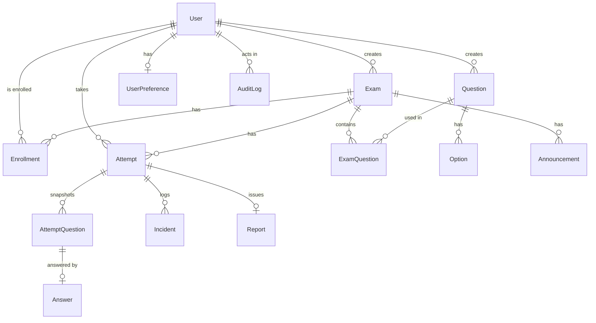

# Database Design

PostgreSQL (Neon) accessed through Prisma 6. The authoritative definition is [schema.prisma](schema.prisma) (copy it to `prisma/schema.prisma` in the app). This document explains it; if the two ever disagree, fix this document.

Related: [architecture.md](architecture.md), [api.md](api.md), [systemdesign.md](systemdesign.md).

---

## 1. Design principles

1. **Constraints do the safety work.** Duplicate attempts, duplicate answers, duplicate enrollments and duplicate verification codes are prevented by unique indexes, not only by application checks.
2. **Snapshot what must not change.** An attempt stores its own copy of every question, its option order, marks and marking scheme. Later edits to the question bank cannot alter an active or finished attempt.
3. **Derive instead of storing what goes stale.** Exam phase (upcoming / ongoing / completed) is computed from `startAt` and `endAt`; only `DRAFT | PUBLISHED | ARCHIVED` is stored.
4. **Server time only.** `startedAt` / `expiresAt` are set by the server; client timestamps are never trusted for enforcement.
5. **Keep real data and sandbox data apart.** Sandbox attempts live in the same tables but are flagged and excluded by one shared filter.

---

## 2. Entity-relationship diagram



Reading it: the **bank side** (`Question`, `Option`, `ExamQuestion`) is editable; the **attempt side** (`Attempt`, `AttemptQuestion`, `Answer`, `Incident`, `Report`) is a frozen record of what a candidate actually saw and did.

---

## 3. Enums

| Enum | Values | Notes |
|---|---|---|
| `Role` | `ADMIN`, `EXAMINER`, `CANDIDATE` | |
| `ExamStatus` | `DRAFT`, `PUBLISHED`, `ARCHIVED` | Stored. `ARCHIVED` is optional (not needed for the demo). Ongoing/completed are derived. |
| `QuestionType` | `MCQ`, `MULTI`, `WRITTEN` | MCQ = single answer; MULTI = multiple select; WRITTEN = manually graded |
| `Difficulty` | `EASY`, `MEDIUM`, `HARD` | Declared by the author; "observed difficulty" is computed in analytics |
| `MultiScheme` | `ALL_OR_NOTHING`, `PARTIAL` | Only meaningful for `MULTI` |
| `AttemptStatus` | `IN_PROGRESS`, `SUBMITTED`, `GRADED` | `SUBMITTED` = finalized but written answers still await grading; there is no separate "expired" status: an expired attempt is finalized into `SUBMITTED` or `GRADED` |
| `IncidentType` | `TAB_HIDDEN`, `FULLSCREEN_EXIT`, `PASTE`, `COPY`, `DISCONNECT`, `RECONNECT`, `LATE_SYNC`, `OTHER` | Indicators for review, not proof of misconduct |

---

## 4. Data dictionary

Types are Prisma types. IDs are `String @id @default(cuid())` unless stated. Every `createdAt` defaults to `now()`. Relation fields such as `Exam.createdBy` or `Attempt.incidents` are Prisma navigation fields, not columns, and are not listed in the tables.

### 4.1 `User`
| Column | Type | Constraints / default | Notes |
|---|---|---|---|
| id | String | PK | |
| email | String | **unique** | Login identifier |
| name | String | | |
| passwordHash | String | | bcrypt/argon2 hash. Never returned by any API. |
| role | Role | | |
| active | Boolean | default `true` | Deactivated users cannot log in or use existing cookies |
| rollNo | String? | | Optional candidate identifier (used by CSV import) |
| createdAt | DateTime | | |

Relations: `examsCreated` (Exam), `questions`, `enrollments`, `attempts`, `preference` (1:1 optional), `auditLogs`.

### 4.2 `Exam`
| Column | Type | Constraints / default | Notes |
|---|---|---|---|
| title | String | | |
| instructions | String | default `""` | Shown before the exam starts |
| startAt, endAt | DateTime | | Availability window. Validation: `endAt > startAt` |
| durationMin | Int | | Per-attempt duration; `<=` window length |
| totalMarks | Float | default `0` | Recomputed server-side from `ExamQuestion.marks` whenever questions change |
| status | ExamStatus | default `DRAFT` | |
| shuffleQuestions, shuffleOptions | Boolean | default `false` | Applied when the attempt snapshot is created |
| resultsPublishedAt | DateTime? | | Set once by "publish results". Non-null means published and the exam is closed to new attempts |
| createdById | String | FK -> User | Owning examiner |
| createdAt | DateTime | | |

Indexes: `(createdById)`, `(status, startAt)`.

### 4.3 `Question` (reusable bank)
| Column | Type | Constraints / default | Notes |
|---|---|---|---|
| topic | String | | Category (indexed with difficulty) |
| difficulty | Difficulty | default `MEDIUM` | |
| type | QuestionType | | |
| text | String | | Rendered as plain text (never as HTML) |
| defaultMarks | Float | default `1` | Pre-fills the per-exam marks |
| negativeMarks | Float | default `0` | Deducted for a wrong MCQ answer; `0` = off |
| multiScheme | MultiScheme | default `ALL_OR_NOTHING` | |
| createdById | String | FK -> User | Questions are visible/editable only by their creator (admins see all) |
| createdAt | DateTime | | |

Index: `(topic, difficulty)`.

### 4.4 `Option`
| Column | Type | Constraints / default |
|---|---|---|
| questionId | String | FK -> Question, `onDelete: Cascade` |
| text | String | |
| isCorrect | Boolean | default `false` |
| order | Int | default `0` |

`WRITTEN` questions have no options.

### 4.5 `ExamQuestion` (assignment of a question to an exam)
| Column | Type | Constraints / default | Notes |
|---|---|---|---|
| examId | String | FK -> Exam, `onDelete: Cascade` | |
| questionId | String | FK -> Question | Blocks hard-deleting a question that is used |
| marks | Float | | Per-exam marks (may differ from `defaultMarks`) |
| order | Int | default `0` | Base order before any shuffling |

Unique: `(examId, questionId)`.

### 4.6 `Enrollment`
| Column | Type | Constraints |
|---|---|---|
| examId | String | FK -> Exam, `onDelete: Cascade` |
| userId | String | FK -> User |
| createdAt | DateTime | default `now()` |

Unique: `(examId, userId)` - a candidate can be enrolled once per exam; re-enrolling is ignored gracefully.

### 4.7 `Attempt`
| Column | Type | Constraints / default | Notes |
|---|---|---|---|
| examId | String | FK -> Exam | |
| userId | String | FK -> User | Candidate (or examiner for a sandbox attempt) |
| status | AttemptStatus | default `IN_PROGRESS` | |
| startedAt | DateTime | default `now()` | Server time |
| expiresAt | DateTime | | `min(startedAt + durationMin, exam.endAt)`. **Never extended.** |
| submittedAt | DateTime? | | Set at finalization |
| score | Float? | | Final total, floored at 0 |
| isSandbox | Boolean | default `false` | |
| sandboxRun | Int | default `0` | Real attempts always `0`; sandbox attempts use 1, 2, 3... |
| lastHeartbeatAt | DateTime? | | Updated by the heartbeat endpoint |
| lateSyncCount | Int | default `0` | Number of late-synced items accepted in the grace window |

Unique: **`(examId, userId, sandboxRun)`** - because real attempts always use `sandboxRun = 0`, this blocks a second real attempt per candidate per exam, while examiners can create many sandbox attempts (each with a new `sandboxRun`). Prisma cannot express a partial unique index, so this counter is used instead.
Indexes: `(status, expiresAt)` (finalization lookups), `(examId, isSandbox)` (monitor/analytics).

### 4.8 `AttemptQuestion` (the per-attempt snapshot)
| Column | Type | Constraints / default | Notes |
|---|---|---|---|
| attemptId | String | FK -> Attempt, `onDelete: Cascade` | |
| questionId | String | **no FK** | Original bank id, used only to group analytics across attempts. It intentionally has no foreign key so the snapshot survives any later change to the bank |
| order | Int | | Final (possibly shuffled) position |
| marks | Float | | Marks for this attempt |
| snapshot | Json | | See 4.8.1 |

Indexes: `(attemptId)`, `(questionId)`. The `id` of this row is what the candidate API calls the question `id`.

#### 4.8.1 `snapshot` JSON shape
```json
{
  "type": "MULTI",
  "text": "Which of the following are prime numbers?",
  "topic": "Mathematics",
  "difficulty": "EASY",
  "negativeMarks": 0,
  "multiScheme": "PARTIAL",
  "options": [
    { "id": "<Option.id>", "text": "2",  "isCorrect": true  },
    { "id": "<Option.id>", "text": "9",  "isCorrect": false },
    { "id": "<Option.id>", "text": "11", "isCorrect": true  }
  ]
}
```
`options` is stored **already in shuffled order** (if `shuffleOptions`). `isCorrect` exists only here and in `Option` - it is stripped before anything is sent to a candidate.

### 4.9 `Answer`
| Column | Type | Constraints / default | Notes |
|---|---|---|---|
| attemptQuestionId | String | **unique**, FK -> AttemptQuestion, `onDelete: Cascade` | One answer row per attempt question |
| response | Json? | | See 4.9.1. `null` = unanswered |
| flagged | Boolean | default `false` | Marked for review |
| seq | Int | default `0` | Highest client sequence number accepted for this answer |
| savedAt | DateTime | default `now()` | |
| awardedMarks | Float? | | `null` = not yet graded. Objective answers: set at finalization. Written: set by the examiner |
| feedback | String? | | Examiner comment on a written answer |
| gradedById | String? | no FK | Examiner who graded |
| gradedAt | DateTime? | | |

#### 4.9.1 `response` JSON shape
| Question type | Shape | Cleared answer |
|---|---|---|
| `MCQ` | `{ "optionIds": ["<id>"] }` (max 1) | `{ "optionIds": [] }` |
| `MULTI` | `{ "optionIds": ["<id>", "<id>"] }` | `{ "optionIds": [] }` |
| `WRITTEN` | `{ "text": "..." }` (max 20000 chars) | `{ "text": "" }` |

At finalization an `Answer` row is created for every question that has none (`response = null`) so that `awardedMarks` exists for every question of a finished attempt.

### 4.10 `Incident`
| Column | Type | Constraints |
|---|---|---|
| attemptId | String | FK -> Attempt, `onDelete: Cascade` |
| type | IncidentType | |
| meta | Json? | Small, size-limited (e.g. `{ "durationMs": 4200 }`) |
| at | DateTime | default `now()` |

Index: `(attemptId, at)`.

### 4.11 `Announcement`
| Column | Type | Constraints |
|---|---|---|
| examId | String | FK -> Exam, `onDelete: Cascade` |
| message | String | |
| at | DateTime | default `now()` |

Index: `(examId, at)`.

### 4.12 `Report` (verifiable result)
| Column | Type | Constraints | Notes |
|---|---|---|---|
| attemptId | String | **unique**, FK -> Attempt | One report per attempt |
| verifyCode | String | **unique** | Random, unguessable (16+ characters) |
| hash | String | | SHA-256 of the canonical result payload `attemptId\|examId\|score\|issuedAt` |
| issuedAt | DateTime | default `now()` | |

Rows are created when results are published. The public verify endpoint recomputes the hash from live data and compares it with `hash`, so a result altered after issuance fails verification.

### 4.13 `UserPreference`
| Column | Type | Notes |
|---|---|---|
| userId | String | PK and FK -> User (1:1) |
| prefs | Json | `{ "theme", "fontSize", "density", "palettePosition" }` (see [frontend.md](frontend.md) section 9) |

### 4.14 `AuditLog`
| Column | Type | Notes |
|---|---|---|
| actorId | String? | FK -> User (nullable for system actions) |
| action | String | e.g. `exam.publish`, `results.publish`, `grade.update`, `user.update`, `import.questions` |
| entity, entityId | String, String? | What was affected |
| meta | Json? | Before/after values or counts |
| at | DateTime | default `now()` |

Index: `(entity, entityId)`.

---

## 5. Referential actions (what happens on delete)

| Parent -> Child | Action | Reason |
|---|---|---|
| Question -> Option | Cascade | Options are meaningless without the question |
| Exam -> ExamQuestion / Enrollment / Announcement | Cascade | Owned by the exam |
| Attempt -> AttemptQuestion / Incident | Cascade | Owned by the attempt |
| AttemptQuestion -> Answer | Cascade | Owned by the attempt question |
| Question -> ExamQuestion | Restrict (default) | A question used by an exam cannot be hard-deleted (API returns 409) |
| Exam -> Attempt, User -> * | Restrict (default) | Completed attempts and results must be retained (3.8). Deactivate users instead of deleting them |

The application does not expose hard deletes of exams or attempts.

---

## 6. Integrity rules and how each is enforced

| Rule | Enforcement |
|---|---|
| One real attempt per candidate per exam | Unique `(examId, userId, sandboxRun)` with `sandboxRun = 0`; start endpoint catches the unique violation and returns the existing attempt |
| One answer row per attempt question | Unique `attemptQuestionId` |
| One enrollment per exam/candidate | Unique `(examId, userId)` |
| A question appears once per exam | Unique `(examId, questionId)` |
| Exactly one finalization per attempt | Conditional update `status: IN_PROGRESS -> SUBMITTED`; only the caller whose update affects 1 row continues |
| Out-of-order or repeated autosaves are harmless | `seq` check: write only if incoming `seq` > stored `seq` |
| Active attempt cannot change | Snapshot in `AttemptQuestion` |
| Verification codes cannot collide | Unique `verifyCode` |
| Written marks within bounds | Service validation: `0 <= awardedMarks <= AttemptQuestion.marks` |
| Sandbox data never counts | `isSandbox = false` filter in one shared helper used by monitor, submissions, analytics, reports, publish and enrollment-status queries |

---

## 7. Transactions and key algorithms

PostgreSQL's default isolation (Read Committed) is sufficient because every race is closed by a unique constraint or a conditional update, not by long-lived locks.

### 7.1 Start an attempt (one transaction)
```
BEGIN
  verify enrollment, exam PUBLISHED, now within [startAt, endAt], resultsPublishedAt is null
  existing = attempt where (examId, userId, sandboxRun = 0)
  if existing.status = IN_PROGRESS -> return it (resumed = true)
  if existing exists (finished)    -> 409 CONFLICT
  expiresAt = min(now + durationMin, exam.endAt)
  create Attempt
  load ExamQuestion rows (+ Question + Option); shuffle order/options if enabled
  create AttemptQuestion rows with full snapshot (including isCorrect)
COMMIT
on unique violation (two tabs started at once): re-read and return the existing attempt
```

### 7.2 Save one answer (per item)
```
if now <= expiresAt                          -> accepted
elif now <= expiresAt + GRACE_MS and elapsedMs <= (expiresAt - startedAt) in ms
                                             -> accepted as late sync (lateSyncCount++, LATE_SYNC incident)
else                                         -> rejected_late
validate response against the snapshot       -> else rejected_invalid
updated = UPDATE answer SET ... WHERE attemptQuestionId = X AND seq < incoming.seq
if updated = 0:
    if no row exists: INSERT (on unique violation: retry the UPDATE once)
    else:             ignored_stale
```

### 7.3 Finalize an attempt (one transaction)
```
BEGIN
  n = UPDATE attempt SET status = SUBMITTED, submittedAt = now WHERE id = X AND status = IN_PROGRESS
  if n = 0 -> already finalized: return current state (idempotent)
  create Answer rows (response null) for unanswered questions
  grade objective answers per snapshot -> awardedMarks; unanswered WRITTEN -> 0
  score = max(0, sum(awardedMarks))
  status = GRADED if no WRITTEN answer with a non-empty response lacks awardedMarks, else SUBMITTED
COMMIT
```

### 7.4 Manual grading
```
BEGIN
  validate: answer is WRITTEN, attempt finalized, results not yet published, 0 <= marks <= max
  UPDATE answer SET awardedMarks, feedback, gradedById, gradedAt
  recompute score = max(0, sum of awardedMarks); set GRADED when no ungraded written answers remain
  insert AuditLog (grade.update)
COMMIT
```

### 7.5 Publish results (one transaction)
```
BEGIN
  finalizeIfExpired for IN_PROGRESS attempts of the exam
  blockers = attempts still IN_PROGRESS or with ungraded written answers
  if blockers -> 409 with details (nothing changes)
  set exam.resultsPublishedAt = now (if null)
  create Report rows (random verifyCode, SHA-256 hash) for GRADED real attempts without one
  insert AuditLog (results.publish)
COMMIT
```

---

## 8. Scoring definitions

| Type / scheme | Awarded marks for an answered question | Unanswered |
|---|---|---|
| MCQ, correct option | `marks` | 0 |
| MCQ, wrong option | `0`, or `-negativeMarks` when `negativeMarks > 0` | 0 (no deduction) |
| MULTI `ALL_OR_NOTHING` | `marks` only if the selected set equals the correct set, else 0 | 0 |
| MULTI `PARTIAL` | `marks * max(0, (correctPicked - wrongPicked) / totalCorrect)` | 0 |
| WRITTEN | Examiner-awarded, `0 <= awarded <= marks` | 0 |

Attempt `score = max(0, sum of awardedMarks)`. Percentage = `score / sum(AttemptQuestion.marks) * 100`, using the attempt's own snapshot marks (not the live exam total). Pass if percentage >= `PASS_PERCENT` (default 40).

---

## 9. Analytics queries (definitions)

All analytics use **real** attempts (`isSandbox = false`) with status `GRADED`, unless stated otherwise.

**Exam level**
- Attempt counts: enrolled (count of `Enrollment`), attempted (real attempts), graded.
- Score statistics: average, median, highest, lowest of `Attempt.score`; pass rate against `PASS_PERCENT`.
- Distribution: ten buckets of 10 percentage points over score percentage.
- Average time used: `submittedAt - startedAt`, capped at `durationMin`.

**Question level** - grouped by `AttemptQuestion.questionId` across the exam's attempts:
- `correctPct`: share of attempts where `awardedMarks >= marks` (full marks), for MCQ/MULTI.
- `skippedPct`: share where `response` is `null`, an empty `optionIds` array, or empty text.
- `mostChosenWrongOption`: most frequent option id in `response.optionIds` where the snapshot marks that option `isCorrect = false`, resolved to its text from the snapshot (MCQ/MULTI only).
- `avgMarksPct`: average `awardedMarks / marks` (used for WRITTEN questions).
- `observedDifficulty`: `correctPct >= 70` -> EASY, `40 <= correctPct < 70` -> MEDIUM, `< 40` -> HARD (compared with the declared difficulty).
- Flags: `LOW_CORRECT` when `correctPct < 20`; `HIGH_SKIPPED` when `skippedPct > 30`.

These are computed in application code from a small number of grouped queries (no materialized views needed at this scale).

---

## 10. Indexing summary

| Index | Serves |
|---|---|
| `Exam(createdById)` | Examiner's exam list |
| `Exam(status, startAt)` | Candidate lists, publish/availability checks |
| `Question(topic, difficulty)` | Question bank filters |
| `Attempt(status, expiresAt)` | Finding attempts that need lazy finalization |
| `Attempt(examId, isSandbox)` | Monitor, submissions, analytics |
| `AttemptQuestion(attemptId)` | Loading a paper |
| `AttemptQuestion(questionId)` | Question analytics grouping |
| `Incident(attemptId, at)` | Incident timeline |
| `Announcement(examId, at)` | "Announcements since" query |
| `AuditLog(entity, entityId)` | Audit trail lookup |
| Unique indexes | Integrity rules in section 6 |

---

## 11. Seed data (`prisma/seed.ts`)

Fictional data only.

| Item | Content |
|---|---|
| Users | `admin@exam.test` / `Admin@123` (ADMIN); `examiner@exam.test` / `Exam@123` (EXAMINER); `candidate1@exam.test` ... `candidate10@exam.test` / `Cand@123` (CANDIDATE) |
| Question bank | 30+ questions across 3 topics, mixed MCQ / MULTI / WRITTEN and difficulties, owned by the seeded examiner |
| Open exam | PUBLISHED, window covering "now", all candidates enrolled (for live demos) |
| Draft exam | DRAFT with a few questions (to demo review-before-publish) |
| Completed exam | PUBLISHED, window in the past, graded attempts with varied scores, results published, `Report` rows (for analytics and PDF/QR demos) |

The seed should be idempotent (safe to run twice) so it can be re-run before the demo.

---

## 12. Migrations and workflow

- Develop with `npx prisma migrate dev --name <change>`; commit the generated migration folder.
- Production: `npx prisma migrate deploy` against the **direct** Neon URL (`DIRECT_URL`); the app itself uses the **pooled** URL (`DATABASE_URL`).
- Only Member 1 edits `schema.prisma`. After a schema change, everyone pulls and runs `npx prisma generate`.
- Pin Prisma to v6 (see [architecture.md](architecture.md) section 9).

---

## 13. Retention and privacy

- Completed attempts, answers, results and reports are kept (3.8: "retain completed attempts and their results for later review").
- Passwords are stored only as hashes. Answer keys exist only in `Option` and in attempt snapshots, and are never included in candidate-facing responses or in PDFs.
- Incident `meta` is limited to small structured values; no screenshots, keystrokes or media are stored.
