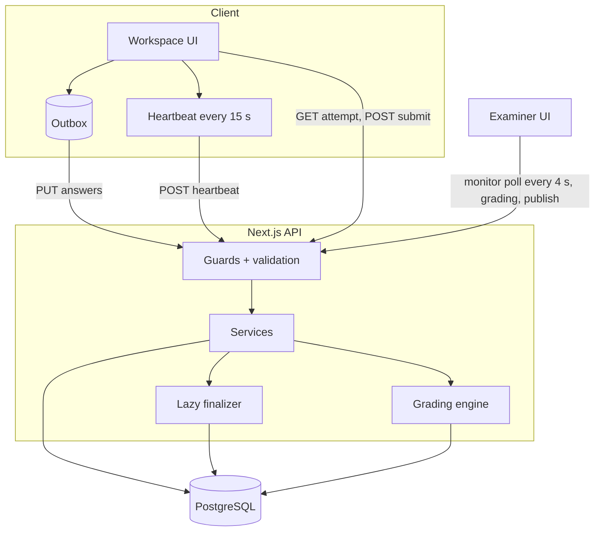
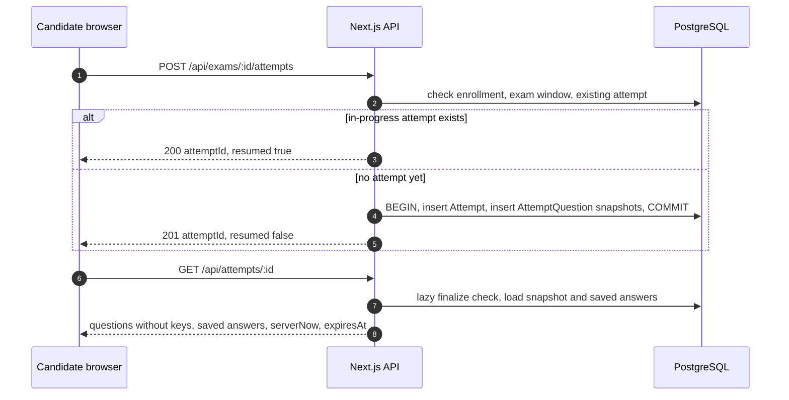
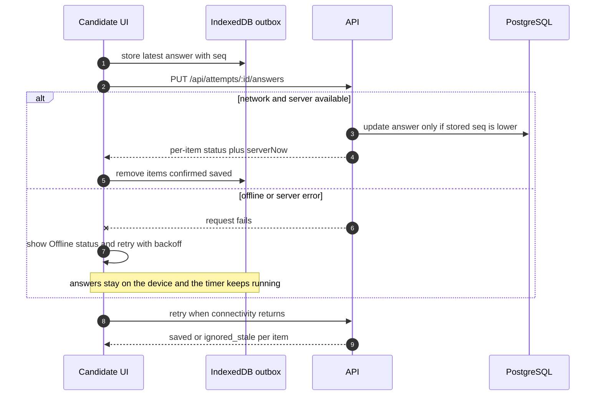
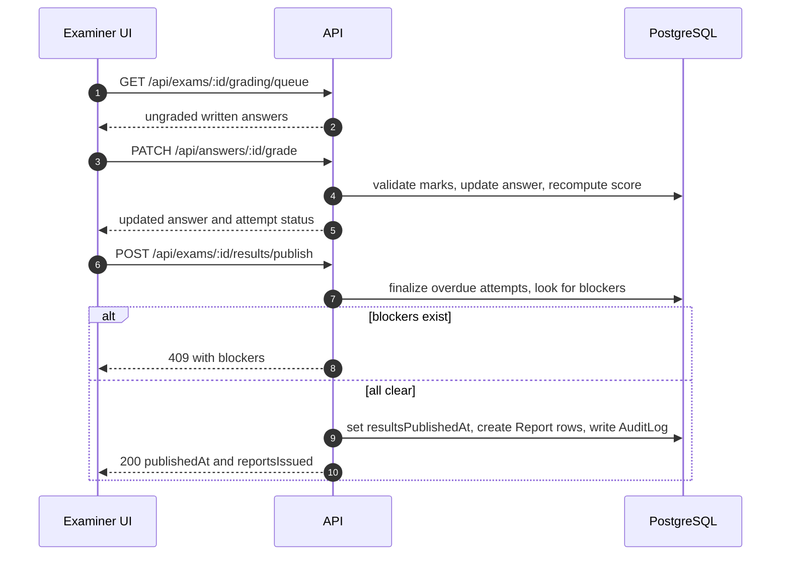
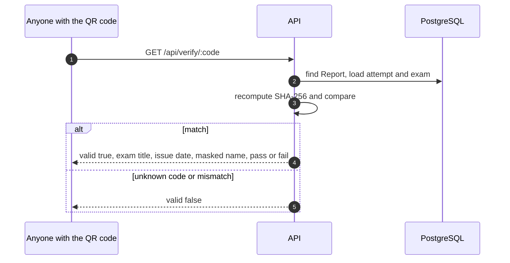
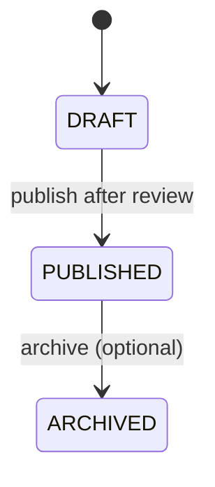
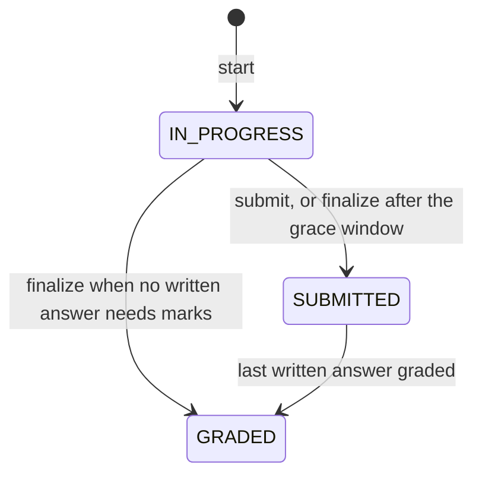

# System Design

How the Secure Examination Management System behaves as a whole: requirements, load assumptions, end-to-end flows, state machines, consistency and failure handling, security, and the reasoning behind the key trade-offs.

Related: [architecture.md](architecture.md) (structure), [database.md](database.md) (data), [api.md](api.md) (contracts), [frontend.md](frontend.md) (UI).

---

## 1. Scope and requirements

### 1.1 Functional requirements and where each is designed
| Spec item | Requirement | Designed in |
|---|---|---|
| 3.1 | Authentication, role-based access enforced on the backend | architecture.md 5.1-5.2; api.md 3-4 |
| 3.2 | Exam setup and lifecycle (draft, published, ongoing, completed), review before publish | api.md 7; database.md 3 |
| 3.3 | Question bank, MCQ / multi-select / written, randomization with preserved marking scheme | api.md 6; database.md 4.8 (snapshot) |
| 3.4 | Enrollment, candidate dashboard, access window | api.md 8, 10, 11.1 |
| 3.5 | Exam workspace, autosave, resume, enforced time limit | frontend.md 8 and 10; api.md 11 |
| 3.6 | Monitoring, announcements, incidents (not conclusive) | api.md 12; frontend.md 12 and 14 |
| 3.7 | Auto-grading incl. multi-select rules, manual grading, consistent state | database.md 7-8; api.md 13 |
| 3.8 | Controlled publishing, own-results-only, analytics, retention | api.md 14-15; database.md 13 |
| 4.1 | Network-aware interface | frontend.md 10.4 |
| 4.2 | PDF reports | api.md 16.1-16.2 |
| 4.3 | Examination sandbox | api.md 11.1; frontend.md 14 |
| 4.4 | Bulk import with validation | api.md 9 |
| 4.5 | Question analytics | api.md 15.2; database.md 9 |
| 4.6 | Verifiable reports | api.md 16.3; database.md 4.12 |
| 4.7 | Customizable workspace | frontend.md 9 |
| 4.8 | Digital scratchpad | frontend.md 11 |
| 5.3 (chosen) | Failure-resilient examinations | section 7 below |
| 5.1 (light) | Privacy-preserving integrity signals | frontend.md 12; api.md 11.6 |
| Section 06 | Server-side authorization, server-enforced timing, no duplicate submissions, validation, free tooling | architecture.md section 1 |

### 1.2 Non-functional requirements
| Quality | Target |
|---|---|
| Integrity | No lost, duplicated or reordered-into-wrongness answers; scores always consistent with stored answers |
| Availability during an exam | A brief network or server hiccup must not lose work or silently change time |
| Security and privacy | Answer keys and other users' data never exposed; minimal personal data in public views |
| Performance | Interactions feel immediate; autosave never blocks typing |
| Cost | Free tiers only |
| Maintainability | Layered code, shared validation, documented decisions |

### 1.3 Out of scope (deliberately)
Live video proctoring, email/SMS delivery, multi-institution tenancy, payment, native mobile apps. The system is a single-tenant web application.

---

## 2. Capacity assumptions (illustrative, for sizing decisions)

The demo will be far smaller than this; the numbers show the design is not fragile at a realistic classroom scale.

Assume **200 candidates** taking one exam at once, 30 questions, 60 minutes.

| Traffic | Assumption | Rate |
|---|---|---|
| Heartbeats | one per candidate every 15 s | 200 / 15 = about 13 requests/s |
| Autosave | one answer change per candidate per ~20 s, debounced and batched | about 10 requests/s |
| Monitor polling | 2 examiners, every 4 s | about 0.5 requests/s (heavier aggregate queries) |
| **Total steady state** | | **about 25 requests/s** |

Bursts to plan for:
- **Exam start:** up to 200 near-simultaneous `start attempt` calls, each inserting about 30 `AttemptQuestion` rows in one transaction (about 6,000 small inserts). Mitigations: the instructions step naturally staggers starts; the transaction is short; a unique constraint makes duplicate starts safe.
- **Exam end:** a burst of submits plus final autosave flushes; submit is a single short transaction per attempt.
- **Payload size:** the attempt load response is tens of KB for 30 questions.

Practical hint: the free database may need a moment to wake after being idle, and serverless functions have cold starts. Open the app a few minutes before the demo. If the pooled Neon connection produces prepared-statement errors under Prisma, add `?pgbouncer=true` to `DATABASE_URL` (Prisma's documented option for PgBouncer-style pooling).

---

## 3. High-level data flow

---

## 4. Core flows

### 4.1 Start and load an attempt

Why it is safe: the unique `(examId, userId, sandboxRun)` index means two simultaneous starts cannot create two attempts; the loser re-reads and returns the existing one.

### 4.2 Answering, with autosave and an outage

### 4.3 Submission, expiry and the grace window
Timeline of one attempt (times relative to `expiresAt`):

| Moment | Server behaviour | Client behaviour |
|---|---|---|
| Before `expiresAt` | Accepts answers normally | Normal workspace |
| `expiresAt` reached | Attempt stays `IN_PROGRESS`; `remainingMs = 0`, `inGrace = true` | Inputs locked; flush outbox, then call submit |
| `expiresAt` to `expiresAt + 120 s` | Accepts buffered answers only if `elapsedMs <= duration`; counts them as late syncs and records `LATE_SYNC` | Keeps retrying flush and submit if offline |
| Candidate submits at any time | Finalizes immediately (idempotent) | Shows "Submitted" |
| After `expiresAt + 120 s` | Next access finalizes the attempt with answers already accepted; further items are `rejected_late` | Shows "finalized with the answers saved before time ran out" |

**Lazy finalization:** there is no background worker. Any read or write that touches an overdue attempt (`GET attempt`, autosave, submit, examiner monitor and submissions, candidate dashboard, publish results) finalizes it first. Publishing results forces finalization of every overdue attempt of that exam, so no result depends on a candidate returning.

### 4.4 Grading and publishing

### 4.5 Verifying a result

---

## 5. State machines

### 5.1 Exam

Within `PUBLISHED`, the displayed phase is **derived**: `UPCOMING` (now before `startAt`), `ONGOING` (between `startAt` and `endAt`), `COMPLETED` (after `endAt`). There is no unpublish. Setting `resultsPublishedAt` closes the exam to new attempts.

### 5.2 Attempt

`SUBMITTED` and `GRADED` are final with respect to answers; `GRADED` additionally means the score is complete.

---

## 6. Consistency and concurrency

| Scenario | What could go wrong | Defence |
|---|---|---|
| Double click / repeated submit | Two grading runs, duplicate results | Conditional update `IN_PROGRESS -> SUBMITTED`; only the request that changes a row grades; repeats return current state |
| Two tabs starting the same attempt | Two attempts | Unique `(examId, userId, sandboxRun)` plus re-read on conflict |
| Autosaves arrive out of order or twice | Older answer overwrites newer one | Per-answer `seq`; write only when incoming `seq` is higher |
| Two tabs both editing | Equal `seq` values collide and one edit is ignored | Web Locks: one writable tab per attempt (frontend.md 10.6) |
| Submit races with an in-flight autosave | Answer saved after grading | Both check status inside their transaction; after finalization items return `rejected_late` |
| Examiner edits a question mid-exam | Candidates see changing papers | Snapshot per attempt |
| Examiner grades while publishing | Published result changes | Publish checks blockers in one transaction; grading is rejected after publication |
| Publishing while someone is still writing | Incomplete results | Blockers: any `IN_PROGRESS` attempt (after forced finalization of overdue ones) or ungraded written answer stops publication |
| Two examiners grading the same answer | Lost update | Last write wins, both recorded in `AuditLog`; rare (an exam has one owning examiner) |

Isolation level is PostgreSQL's default (Read Committed); correctness comes from constraints and conditional updates rather than long locks, which keeps transactions short and serverless-friendly.

---

## 7. The innovation: failure-resilient examinations (5.3)

**Problem.** Internet outages, device failures and power cuts unfairly lower candidates' results, but naive fixes (pausing the clock, resetting the exam, letting people continue later) create loopholes for extra time.

**Who is affected.** Honest candidates on unstable connections or hardware; examiners who then face disputes.

**Solution.**
1. **Device-first saving.** Every change is written to IndexedDB before any network call; the outbox drains when connectivity returns, idempotently (per-answer `seq`).
2. **Server-authoritative clock.** `expiresAt` is fixed in the database at start. Disconnecting neither pauses nor extends it; the UI says so.
3. **Bounded late sync.** Answers that could not be delivered are accepted for a short grace window after expiry, but only if the client-reported `elapsedMs` (measured on a server-calibrated clock) shows they were produced within the allowed duration. Each such acceptance is counted and logged as `LATE_SYNC` for the examiner.
4. **Resume anywhere.** Refresh, crash or switching device resumes the same attempt with the same remaining time (the start endpoint returns the in-progress attempt). Answers already synced survive even if the original device is lost; unsynced answers on a dead device are the only loss.
5. **Honest UI.** Save status, connection state and offline notices are always visible.

**Why it is fair.** No path grants extra time on request; the grace window is short and symmetrical for everyone; examiners can see every late sync and connection gap.

**Trade-off to state openly.** `elapsedMs` is reported by the client, so a modified client could forge it. The worst case is bounded: an item can only be accepted up to `GRACE_MS` (2 minutes) after `expiresAt`, and every such acceptance is flagged. Possible future hardening: accept a late sync only when heartbeat history shows a connectivity gap around expiry.

**Related fairness note:** because `expiresAt = min(start + duration, exam end)`, a candidate who starts late gets less time. The instructions page states this.

**Light support for 5.1 (integrity).** The workspace logs only coarse events (tab hidden, fullscreen exit, copy/paste) plus server-observed connection gaps, shown to examiners as indicators for review. No camera, screen capture or keystroke logging.

---

## 8. Failure-mode analysis

| Failure | Effect | Handling |
|---|---|---|
| Candidate loses internet | Autosave requests fail | Outbox keeps changes, status chip shows Offline, timer keeps running, sync on reconnect, grace window at the end |
| Browser refresh or crash | Page state lost | Resume from server state, merge outbox, restore position and scratchpad |
| Device dies / power cut | Local state lost | Log in elsewhere and resume the same attempt with the same remaining time; answers synced before the failure are kept |
| API returns 5xx or times out | Save or submit not confirmed | Autosave retries with backoff; submit is idempotent and retried; `failed` state after 60 s of continuous failure |
| Database slow or briefly unavailable | Requests fail | Same as above; no partial writes because each operation is one transaction |
| Serverless cold start / free database waking | First request slow | Warm up before the demo; retries cover transient delays |
| Duplicate or replayed requests | Double effects | Idempotent endpoints, unique constraints, `seq` |
| Device clock wrong or manipulated | Wrong displayed time | Server time is authoritative; client uses a performance-counter anchor |
| Examiner closes the page mid-exam | Monitoring stops | Candidates unaffected; monitor resumes on reopen |
| Candidate never returns after expiry | Attempt stuck `IN_PROGRESS` | Lazy finalization on any later access; publish step forces it |
| Bad import file | Partial garbage data | Dry-run preview, row-level validation, size and row limits, valid rows only |

---

## 9. Security model

### 9.1 Assets
Answer keys, candidate answers and scores, user credentials, exam schedules, result integrity (verifiable reports).

### 9.2 Threats and mitigations
| Threat | Mitigation |
|---|---|
| Candidate reads answer keys from API responses or the page | Keys exist only server-side; candidate payloads built by `toCandidateQuestion()`; PDFs and the verify page contain no keys; grep sweep before release |
| Candidate calls examiner/admin endpoints | `requireRole` on every route; middleware is only a coarse extra layer |
| Accessing another user's attempt or result by guessing an ID | Ownership check on every route; foreign resources return 404 |
| Privilege escalation by sending `role` or other fields | Strict Zod schemas reject unknown keys; role changes only through the admin endpoint |
| Time tampering | Server time and stored `expiresAt`; late items bounded by the grace window |
| Submitting after the deadline | Time check inside the autosave service; finalization after the grace window |
| Replay or duplicate submissions | Idempotent submit; `seq` on answers |
| Credential brute force / user enumeration | Login rate limit; identical failure message for unknown email, wrong password and deactivated account; hashed passwords |
| CSRF | SameSite=Lax httpOnly cookie, JSON bodies, same-origin `Origin` check on mutating requests |
| XSS through question text or written answers | Rendered as plain text, never injected as HTML; React escaping; no `dangerouslySetInnerHTML` |
| Enumerating verification codes | Long random codes, rate limit, uniform `valid: false` response |
| Leaking personal data through public verification | Masked name, exam title, date, pass/fail only |
| Malicious or oversized imports | 2 MB / 2000-row limits, strict row validation, dry run; escape cells that begin with `=`, `+`, `-` or `@` in any CSV the system generates (credentials and error reports) to prevent spreadsheet formula injection |
| SQL injection | Prisma parameterized queries; no raw SQL with user input |
| Over-collection of candidate data | Only coarse event types and small metadata are stored; nothing else |

### 9.3 Residual risks (accepted)
`elapsedMs` forgery within the grace window (flagged), best-effort rate limiting on serverless, advisory-only integrity signals.

---

## 10. Scaling path (if this were to grow)

| Need | Change |
|---|---|
| Thousands of concurrent candidates | Database tier upgrade and connection pooling tuning; index review; cache read-mostly data (exam metadata) |
| Instant announcements and live monitor | Server-sent events or a managed realtime service in place of polling |
| Exact finalization at expiry | Scheduled job or queue worker alongside lazy finalization |
| Heavy PDF generation | Move to a background job producing files in object storage |
| Robust rate limiting | Shared store (for example Redis) instead of per-instance memory |
| Analytics at scale | Read replica or materialized aggregates |
| Multiple institutions | Add a tenant/organization key to users, exams and questions with row-level scoping |

---

## 11. Observability and operations
- Structured JSON error logs with route, user id and error code (no answers, no passwords).
- `AuditLog` for privileged actions; `Incident` for candidate-side signals.
- Demo-day checklist: seed fresh data, confirm the three test logins on the live URL, warm the app and database, rehearse the network-cut scenario twice, keep a second browser profile signed in as the examiner, have the README test credentials open.

---

## 12. Design decisions summary

| Decision | Reason |
|---|---|
| Server owns time, grading and permissions | Spec requirements; clients cannot be trusted |
| Snapshot per attempt | Preserves assigned questions and marking scheme |
| Derived exam phase | No scheduler needed; never stale |
| Lazy finalization with a grace window | Works on serverless; supports fair late sync |
| Outbox + `seq` | Reliable, idempotent saving across failures |
| Polling instead of sockets | Simplest thing that works on serverless |
| Indicators, not verdicts, for integrity | Privacy and fairness |
| Constraints over locks | Short transactions, easy to reason about |
| One deployable Next.js app | Fastest for a 3-person, 10-hour build; easy to explain |

---

## 13. Assumptions and open points
- Single institution, single time zone for display (timestamps stored in UTC).
- Default thresholds (grace 2 min, heartbeat 15 s, pass mark 40%) are tunable constants in `lib/constants.ts`, not spec requirements.
- Question ownership is per examiner (answer keys are not shared across examiners); sharing across examiners would be a small policy change in the question queries.
- Only one real attempt per candidate per exam; retakes would need a policy and a schema change (for example an attempt number in the unique key).
